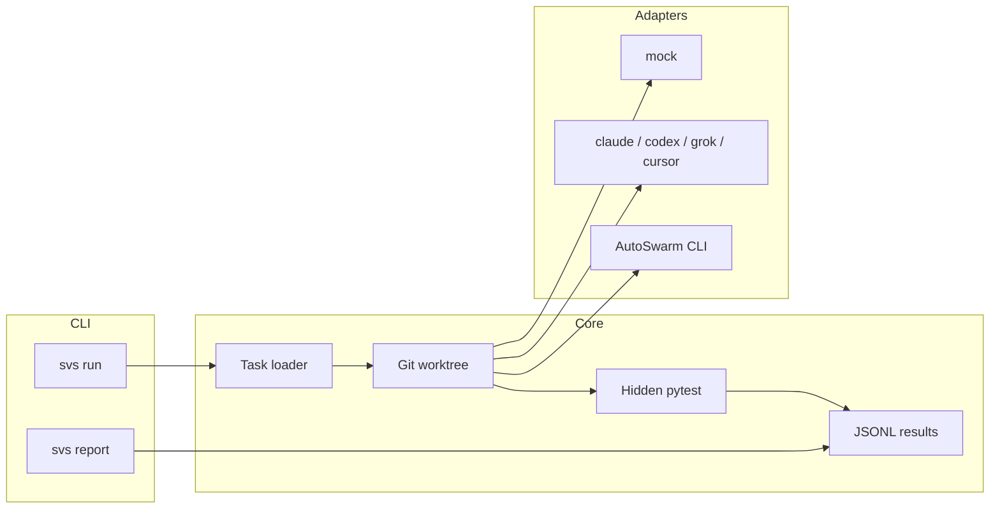

# swarm-vs-solo

Open-source benchmark harness (MIT) that compares a **single coding agent** against an **[AutoSwarm](https://github.com/HKUDS/AutoSwarm)** team on the same coding tasks, measuring **pass rate**, **wall-clock time**, and **token/cost**.

AutoSwarm ships orchestration and CLI delegation, but **no task benchmark**. This project fills that gap with a reproducible runner, pluggable adapters, hidden pytest checks, and CI-friendly mock runs.

## Quickstart

```bash
python3 -m pip install -e ".[dev]"

# Deterministic CI/local run (no API keys)
svs run --tasks builtin --mode solo  --agent mock --results results/runs.jsonl
svs run --tasks builtin --mode swarm --agent mock --results results/runs.jsonl
svs report --results results/runs.jsonl --output results/report
```

Open `results/report/report.md` and the PNG charts alongside it.

### CLI

```text
svs run --tasks <suite> --mode solo|swarm --agent <name> [--results PATH] [--ids ...] [--limit N]
svs report [--results PATH] [--output DIR]
```

| Flag | Description |
| --- | --- |
| `--tasks` | `builtin` built-in suite, a task directory, or SWE-bench-Lite-style `.jsonl` |
| `--mode` | `solo` = direct agent CLI; `swarm` = AutoSwarm delegation (or mock swarm simulation) |
| `--agent` | `mock`, `claude`, `codex`, `grok`, `cursor` |

## Architecture



Each task lives in its own folder (`task.json`, `starter/`, `hidden_tests/`, `golden_fix.json` for mock only). Runs copy `starter/` into an isolated **git worktree**, invoke the adapter, then evaluate by copying hidden tests into a temp directory (agents never see them during execution).

## Built-in task suite

Ten small Python bug-fix tasks ship under `src/svs/tasks/data/builtin/` (add/subtract, fizzbuzz, binary search, etc.). Each task includes:

- `task.json` — id, title, prompt
- `starter/` — buggy workspace committed into the worktree
- `hidden_tests/` — pytest suite used only at evaluation time

## SWE-bench-Lite-style JSONL

Load external manifests (metadata + problem text) from JSONL:

```bash
svs run --tasks tasks/swebench-sample.jsonl --mode solo --agent mock --limit 2
```

Full SWE-bench instances require checking out upstream repos; the loader creates placeholder workspaces and skip tests until you plug in a repo harness.

## Agent adapters

| Agent | Solo | Swarm | Requirements |
| --- | --- | --- | --- |
| `mock` | yes | simulated swarm | none (deterministic golden patches) |
| `claude` | yes | via `autoswarm run --agent claude-code` | `claude` CLI + auth |
| `codex` | yes | via AutoSwarm | `codex` CLI + auth |
| `grok` | yes | via AutoSwarm | `grok` CLI + auth |
| `cursor` | yes | via AutoSwarm | `cursor-agent` CLI + auth |
| AutoSwarm | — | orchestrates child CLI | `pip install autoswarm` + child CLI |

Token and cost fields are parsed from stream-json / AutoSwarm envelopes when present; otherwise they may be zero or estimated.

## Sample results (MOCK)

The committed demo artifacts under [`docs/demo/`](docs/demo/) were generated with the **`mock` adapter only**.

> **MOCK example data** — not real agent performance. Regenerate with:
>
> ```bash
> python3 docs/demo/generate_demo_artifacts.py
> ```

| Agent | Mode | Pass rate | Mean wall (s) | Mean cost ($) |
| --- | --- | ---: | ---: | ---: |
| mock | solo | 100% | ~0.18 | ~0.009 |
| mock | swarm | 100% | ~0.35 | ~0.016 |

See [`docs/demo/report/report.md`](docs/demo/report/report.md) for the full table and charts, and [`docs/demo/swarm-vs-solo-mock.cast`](docs/demo/swarm-vs-solo-mock.cast) for a terminal recording.

## Adding tasks

1. Create `my-suite/my-task/task.json`, `starter/`, and `hidden_tests/`.
2. Optional: `golden_fix.json` with `{"files": {"relative/path.py": "..."}}` for mock runs.
3. Run: `svs run --tasks my-suite --mode solo --agent mock`

## Adding agents

1. Subclass `AgentAdapter` in `src/svs/adapters/`.
2. Register in `src/svs/adapters/registry.py` (`SOLO_ADAPTERS`).
3. Wire CLI invocation and usage parsing (see `_cli_runner.py`).

## Methodology write-up

See [`docs/REPORT.md`](docs/REPORT.md) for the report template, metric definitions, and threats to validity.

## Development

```bash
pip install -e ".[dev]"
pytest
```

GitHub Actions runs the mock suite on Python 3.10 and 3.12 (see [`.github/workflows/ci.yml`](.github/workflows/ci.yml)).

## License

MIT — see [LICENSE](LICENSE).
