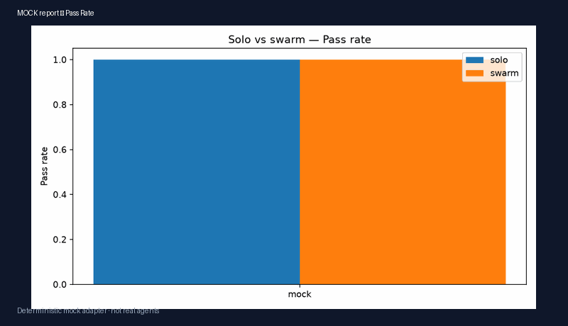
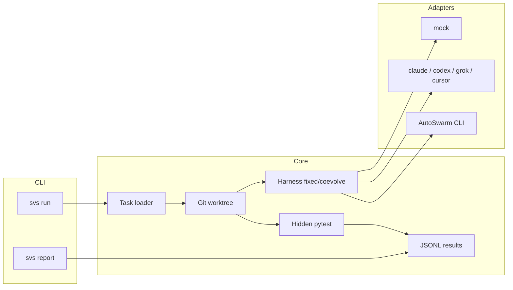
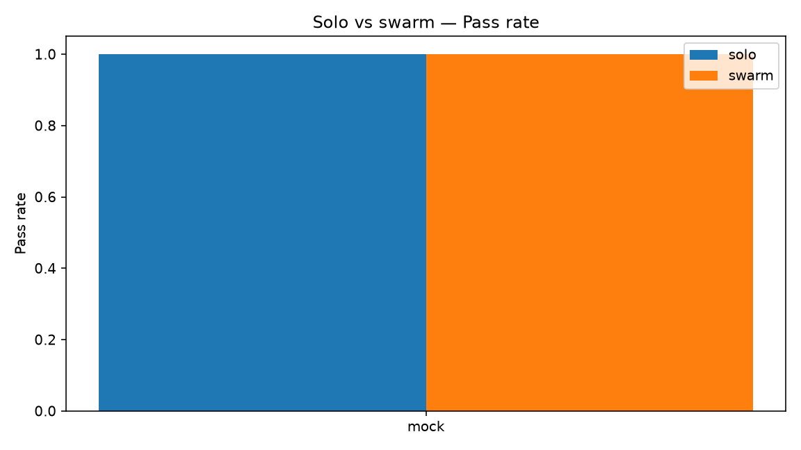
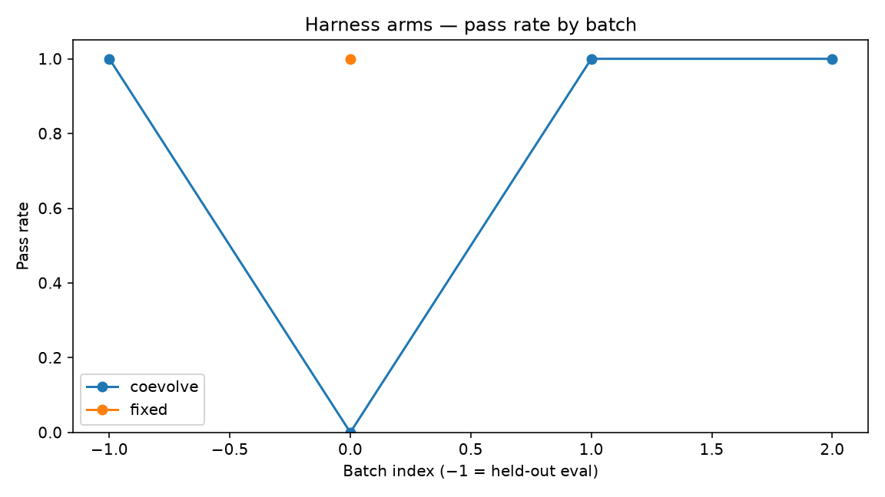

<div align="center">


**Measure whether a swarm of coding agents beats one agent on the same tasks — and whether the harness should co-evolve with policy.**

<br>

[](https://github.com/Sebastianrodaaa/swarm-vs-solo/actions/workflows/ci.yml)
[](LICENSE)
[](https://www.python.org/downloads/)
[](https://github.com/HKUDS/AutoSwarm)

[Quickstart](#quickstart) · [Demo](#demo) · [Usage](#usage) · [Harness experiment](#harness-experiment-fixed-vs-co-evolve) · [Architecture](#architecture) · [Results (MOCK)](#results-mock-example-data) · [Contributing](#contributing)

</div>

---

## Why this exists

[AutoSwarm](https://github.com/HKUDS/AutoSwarm) (MIT) lets a **host** agent delegate work to other coding CLIs (Codex, Claude Code, Grok, Cursor via ACP, and more). It ships strong orchestration, but **no standard task benchmark**.

**swarm-vs-solo** (`svs`) runs the **same** coding tasks under:

- **solo** — one agent CLI works the task directly  
- **swarm** — AutoSwarm delegates to a child agent (or a deterministic mock simulates swarm overhead)

You get **pass rate**, **wall-clock time**, and **token/cost** in JSONL, plus `svs report` for markdown tables and charts.

A second experiment axis compares a **fixed harness** (static prompt, tools, rubric) with a **co-evolving harness** inspired by recent work on training policy and scaffolding together ([CoHARL](https://arxiv.org/abs/2610.36469v1), [co-evolving rubrics](https://arxiv.org/abs/2610.36826v1), [*Your Policy Is Secretly a Harness*](https://huggingface.co/papers/2610.37255)).

## Demo

<p align="center">
  
</p>

<p align="center">
  <sub>
    <strong>MOCK example data</strong> — charts from the committed <code>mock</code> adapter run (solo, swarm, fixed harness, co-evolve harness).
    Terminal recording: <a href="docs/demo/swarm-vs-solo-mock.cast">docs/demo/swarm-vs-solo-mock.cast</a>
    (play with <a href="https://asciinema.org/">asciinema</a>).
  </sub>
</p>

## Quickstart

```bash
git clone https://github.com/Sebastianrodaaa/swarm-vs-solo.git
cd swarm-vs-solo
python3 -m pip install -e ".[dev]"

# No API keys — deterministic mock adapter
svs run --tasks builtin --mode solo  --agent mock --harness fixed --results results/runs.jsonl
svs run --tasks builtin --mode swarm --agent mock --results results/runs.jsonl
svs run --tasks builtin --mode solo  --agent mock --harness coevolve --batch-size 2 \
  --run-dir results/coevolve-run --results results/runs.jsonl
svs report --results results/runs.jsonl --output results/report
```

Open `results/report/report.md`, PNG charts, and (for co-evolve) `results/coevolve-run/harness/rev_*.json`.

## Usage

### Run benchmarks

```bash
svs run --tasks <suite> --mode solo|swarm --agent <name> [options]
```

| Option | Description |
| --- | --- |
| `--tasks` | `builtin`, a directory of task folders, or a SWE-bench-Lite-style `.jsonl` |
| `--mode` | `solo` = direct CLI adapter · `swarm` = AutoSwarm (or mock swarm simulation) |
| `--agent` | `mock`, `claude`, `codex`, `grok`, `cursor` |
| `--harness` | `fixed` (default) or `coevolve` — see [Harness experiment](#harness-experiment-fixed-vs-co-evolve) |
| `--batch-size` | Train tasks per batch when `--harness coevolve` (default: 2) |
| `--run-dir` | Store versioned harness JSON revisions (recommended for co-evolve) |
| `--results` | JSONL output path (default: `results/runs.jsonl`) |
| `--ids` | Run only these task ids |
| `--limit` | Cap number of tasks (useful for JSONL suites) |
| `--timeout` | Per-task timeout in seconds (default: 600) |

### Report

```bash
svs report [--results PATH] [--output DIR]
```

Aggregates JSONL by `(agent, mode, harness)` and writes `report.md` plus PNG charts. When co-evolve rows are present, adds harness batch curves, revision counts, and held-out eval cost/time.

### Examples

```bash
# Subset of built-in tasks
svs run --tasks builtin --mode solo --agent mock --ids fix_add fix_fizzbuzz

# Compare harness arms on mock (MOCK data)
svs run --tasks builtin --mode solo --agent mock --harness fixed --limit 8 --results results/runs.jsonl
svs run --tasks builtin --mode solo --agent mock --harness coevolve --limit 8 --run-dir results/coevolve-run --results results/runs.jsonl

# SWE-bench-Lite-style manifest (placeholder workspaces)
svs run --tasks tasks/swebench-sample.jsonl --mode solo --agent mock --limit 2

# Live agent (requires CLI + credentials on your machine)
svs run --tasks builtin --mode solo --agent claude --limit 1
svs run --tasks builtin --mode swarm --agent claude --limit 1   # uses autoswarm CLI
```

## Harness experiment (fixed vs co-evolve)

| Arm | What stays constant | What changes |
| --- | --- | --- |
| **fixed** | System prompt, tool list, grading rubric | Nothing — baseline scaffolding |
| **coevolve** | Task split + batch schedule | After each **train** batch, a harness updater rewrites prompt, tools, and rubric from failures; each revision is saved under `--run-dir/harness/rev_NNN.json` |

**Leakage guard:** tasks are split ~70% train / ~30% eval (hash of `task_id`). The updater sees **train failures only**. Eval tasks run once at the end; `svs report` highlights **held-out eval** metrics for harness comparisons.

Works with all adapters (`mock`, `claude`, `codex`, `grok`, `cursor`). The mock adapter drives the full co-evolve loop deterministically in CI.

Design notes and threats to validity: [`docs/REPORT.md`](docs/REPORT.md#harness-experiment-fixed-vs-co-evolve).

## Architecture

Each task is a folder with `task.json`, `starter/` (buggy workspace), and `hidden_tests/` (pytest, never shown to the agent during the run). Every run copies `starter/` into an isolated **git worktree**, invokes the adapter with the active harness, then evaluates by copying hidden tests into a temp directory.



| Component | Role |
| --- | --- |
| **Task loader** | Built-in suite under `src/svs/tasks/data/builtin/` or external JSONL |
| **Harness** | Versioned prompt, tools, rubric; co-evolve updater between train batches |
| **Worktree** | Fresh git snapshot per run — no cross-task leakage |
| **Adapters** | Pluggable CLI backends; swarm mode wraps `autoswarm run` |
| **Evaluate** | Hidden pytest with `PYTHONPATH` including `workspace/src` |
| **Report** | Solo vs swarm + harness arm charts (eval split for co-evolve) |

## Built-in tasks

**10** self-contained Python bug-fix tasks (add/subtract, fizzbuzz, binary search, palindrome, flatten, merge, parentheses, etc.).

```text
src/svs/tasks/data/builtin/<task-id>/
  task.json
  starter/          # agent workspace seed
  hidden_tests/     # pytest (evaluation only)
  golden_fix.json   # mock adapter only — not visible to live agents
```

## Agent adapters & requirements

| Agent | Solo | Swarm | What you need |
| --- | :---: | :---: | --- |
| `mock` | yes | simulated | Nothing — used in CI (incl. co-evolve loop) |
| `claude` | yes | AutoSwarm child | `claude` CLI + auth |
| `codex` | yes | AutoSwarm child | `codex` CLI + auth |
| `grok` | yes | AutoSwarm child | `grok` CLI + auth |
| `cursor` | yes | AutoSwarm child | `cursor-agent` CLI + auth |
| AutoSwarm | — | orchestrator | `autoswarm` on PATH + configured child provider |

Token and cost fields are parsed from stream-json / AutoSwarm envelopes when present; otherwise they may be zero or estimated from generic rates.

### Extending

<details>
<summary><strong>Add a task</strong></summary>

1. Create `my-suite/my-task/` with `task.json`, `starter/`, and `hidden_tests/`.
2. Optional: `golden_fix.json` for mock CI (`{"files": {"path.py": "..."}}`).
3. `svs run --tasks my-suite --mode solo --agent mock`

</details>

<details>
<summary><strong>Add an agent</strong></summary>

1. Subclass `AgentAdapter` in `src/svs/adapters/`.
2. Register in `src/svs/adapters/registry.py`.
3. Wire CLI invocation and usage parsing (`_cli_runner.py`).

</details>

## Results (MOCK example data)

The table below is copied from the **committed demo run** ([`docs/demo/report/report.md`](docs/demo/report/report.md)). It uses the **`mock` adapter only** — not Claude, Codex, or live swarms.

> **Do not treat these numbers as real benchmark results.** Regenerate demo artifacts with:
>
> ```bash
> python3 docs/demo/generate_demo_artifacts.py
> ```

See the committed report for the full `(agent, mode, harness)` table and harness charts (`harness_pass_rate_by_batch.png`, `harness_revision_count.png`, `harness_eval_cost_time.png`).

<p align="center">
  
  
</p>

For methodology, metrics definitions, and threats to validity, see [`docs/REPORT.md`](docs/REPORT.md).

## Development

```bash
pip install -e ".[dev]"
pytest
```

CI (`.github/workflows/ci.yml`) runs mock `svs run` (solo, swarm, fixed + co-evolve harness) + `svs report` on Python **3.10** and **3.12**, then pytest.

## Contributing

Contributions welcome — especially new **task fixtures**, **adapter improvements**, **harness updaters**, and **fairer swarm baselines**.

1. Fork the repo and create a branch from `main`.
2. Install dev dependencies and run `pytest`.
3. Keep mock-labeled demo data clearly marked; do not commit unlabeled live API results.
4. Open a pull request with a short description and how you tested.

## License

MIT © [Sebastian Roda](LICENSE) — see [LICENSE](LICENSE) for details.
